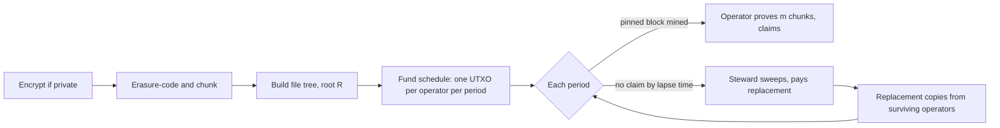

# Proof of Keep

### Paying for storage you can check, enforced by BSV script

Ruth Heasman · Draft 0.3 · 11 November 2026 (first draft 29 October 2026)

---

## Abstract

BSV can prove that a piece of data existed at a given time, cheaply and indefinitely: a transaction, its Merkle path and the block headers are enough. That proof is only useful while someone still has the data. Nodes prune, free indexers are planning to cover less history, and hosting that is paid upfront ends when the payment runs out. So the question is how to pay someone to keep a file for fifty years without trusting them, or anyone else, to hold the money or report honestly.

Proof of Keep answers it with an ordinary output script. At the start of a deal the whole storage fee is locked on-chain as a schedule of UTXOs, one per operator per period. Each UTXO pays out only to its operator, and only when they present a set of randomly chosen chunks of the file with Merkle paths to the deal's root. The choice of chunks is derived from the header of the block at a height fixed for that period, which the script checks against a proof-of-work floor, so nobody can know the challenge in advance without paying for the work. Periods an operator fails to claim lapse to a steward, who pays a replacement from the remaining copies. It is designed to be the on-chain payment output that bstore, a storage market on BSV, reserves but does not yet define (section 2.1).

A working prototype runs every rule through the `@bsv/sdk` script interpreter: 34 checks pass and 13 deliberate mutations of the script are all caught. A claim through the keep path has been mined on BSV mainnet. At cold-storage prices, keeping 1 GiB for fifty years costs about $7 with three full copies, or about $2 if the file is split across five operators so that any three of them can rebuild it. The on-chain fees over a whole deal come to well under a dollar.

Proof of Keep does not prove that three operators hold three independent copies, it carries BSV price risk, and version 1 leaves a large footprint in the UTXO set. Section 8 covers each.

---

## 1. The problem: proof is not availability

Section 7 of the Bitcoin whitepaper describes pruning spent transactions to reclaim disk space, and section 8 describes verifying a payment with block headers and a Merkle branch instead of the full chain. Together they give BSV its useful property for records: you can prove a transaction existed without trusting whoever kept it, and nobody has to keep everything.

The flip side is that nobody is obliged to keep anything. A hash anchored on-chain proves that some bytes existed by a certain block. If those bytes are gone, the anchor proves only that they once existed. Every BSV product that promises permanence (on-chain publishing, notarised evidence, patient records, music ownership) depends on somebody still holding the data, and today that is a hope rather than an obligation anyone is paid to meet.

Three facts make this pressing:

- **Free history is shrinking.** BRC-234, proposed in October 2026, sets out a shared schedule for participating indexers to reduce the transaction, address and script data they guarantee to serve for free, in 27 stages anchored to block 1,000,000. It is voluntary and explicitly not an industry-wide restriction, but its stated aim is to move applications towards keeping their own records and paying for indexing.
- **Advertised hosting is not checked hosting.** UHRP (BRC-26) lets a host advertise, with a UTXO token, that it serves a file with a given SHA-256 hash until an expiry time. That tells you who says they have the file. Nothing in UHRP checks that they still do, and payment is made upfront for a term. bstore (Lightweb, October 2026) adds paid challenges on top of adverts like these, but checks them off-chain, and its own specification says enforcement is reputation.
- **The web loses data quickly without incentives.** Pew Research found in 2024 that 38% of webpages that existed in 2013 were no longer accessible a decade later.

A solution needs five properties:

1. Payment is released only against evidence that the data is still held.
2. The evidence cannot be prepared in advance.
3. No custodian holds the money while the deal runs.
4. Loss is detected while other copies still exist.
5. There is a way to replace an operator who fails.

Proof of Keep provides 1 to 5 within limits stated in sections 5 and 8. It does not provide independent-copy guarantees or protection against BSV price changes.

---

## 2. What already exists, and what is new

None of the individual mechanisms here are new, and the core idea of checking a storage challenge inside a BSV locking script is sketched in bstore's specification (section 2.1). What Proof of Keep adds is a working, tested script for it, the economic rule that makes it safe to fund, and the erasure coding that makes it small enough to run on-chain, all with no dedicated chain, token, consensus change, oracle or custodian.

| Work | What it contributes | How it is enforced |
|---|---|---|
| Juels and Kaliski, *PORs* (2007); Ateniese et al., *PDP* (2007) | Spot-checking random blocks of an erasure-coded file proves the whole file is recoverable with high probability | A verifier who issues the challenges |
| Sia (Vorick and Champine, 2014) | Hosts prove a random Merkle segment in each challenge window. The seed is the contract ID hashed with the block before the window. Valid and missed proofs pay different addresses | Sia's own consensus rules and coin |
| Filecoin | Proof of Spacetime: every sector is proven once in each 24-hour period, split into 48 half-hour deadlines. Missed proofs forfeit pledged collateral. Sealing makes replicas expensive to fake | Filecoin's chain and FIL |
| Arweave | An endowment pays for long-term storage, assuming storage costs fall by 0.5% a year and covering the first 200 years | Arweave's chain and AR |
| sCrypt (Liu, 2021) | Checking a block header's proof of work inside a BSV script. A contract should lock no more value than forging a header would cost | BSV script |
| UHRP (BRC-26) | Content-addressed hosting adverts on an overlay, with expiry | BSV overlay (BRC-22, BRC-24) |
| bstore (Lightweb, 2026) | Object storage as a market on BSV. Providers advertise holding with UHRP-style tokens, writers pay bounties by rank to providers that pass a challenge, and anyone can buy renewals and challenges. Challenges sample 4 KiB segments chosen by a recent block's hash, the buyer's nonce and the provider's key. Its section 7.7 sketches checking the same proof in a locking script and reserves a tag for that output | Off-chain: challenges paid over BRC-105, bounties held as the writer's "honor escrow", enforcement by reputation |

Proof of Keep takes Sia's challenge model, uses sCrypt's in-script header check as the randomness source, relies on the PoR result that spot checks plus an erasure code cover the whole file, and replaces both Sia's consensus rules and Arweave's endowment pool with a pre-funded set of UTXOs.

The layering follows the rule in Wright (2026): order on-chain, content off-chain, judgement in the overlay. The deal root and the payment schedule are on-chain. The file is off-chain with the operators. Deciding that an operator has failed and choosing a replacement happens in the overlay, with the steward.

### 2.1 Relationship to bstore

bstore and Proof of Keep solve different halves of the same problem, and they fit together.

bstore is the market and the plumbing: provider software, an S3 gateway, bucket listings a reader can verify from block headers, reads, renewals and bounty races. Its specification is explicit that payment is not tied to a proof on-chain: "No deposit is slashed and no payment is conditional on a proof on chain in this version" (bstore section 20). Its section 7.7, present since its first draft on 4 October 2026, describes the on-chain form: a locking script that derives the challenge from a header checked against a proof-of-work floor and pinned to a height, and checks each sampled segment's Merkle path. bstore defines no such output, and reserves tag type `st` `0x04` for "an output that pays on proof".

Proof of Keep is a working, tested form of that output. It adds three things the sketch leaves open:

1. **A limit on what one output may hold** (section 5.2). One period's total payment must stay under the cost of forging one header at the floor. Without that limit, a challenge seeded by a header can be bought ahead of time.
2. **Erasure coding, which makes the on-chain form affordable.** bstore spot-checks full copies, so it needs about 1,000 samples to catch one missing blob of a 1 GiB object. That is cheap off-chain. In script, a 1,024-sample claim over bstore's 4 KiB segments needs a 427 kB locking script per period and a 4.8 MB claim (measured with this paper's script builder at the depth of 18 that a 1 GiB object needs). With rate-1/2 coding, data is lost only when more than half the chunks are gone, so 16 samples are enough: a 6.8 kB locking script and, at 64 KiB chunks, a 1.06 MB claim.
3. **A prepaid schedule with recovery:** decades of payments fixed at funding time, a lapse path for missed periods, and shards across operators (section 4.10).

The two trees are closer than they look. bstore's proof root is an RFC 6962 tree over an object's 4 KiB segments; Proof of Keep's is a fixed-depth, padded tree over erasure-coded chunks. Both hash a leaf as `SHA-256(0x00 || data)` and a node as `SHA-256(0x01 || left || right)`, so when the number of leaves is a power of two they are the same tree. bstore froze its proof formats so that a later output could pay on proof without a new format (its section 7.7), and that looks achievable: store the erasure-coded encoding as an ordinary bstore object and challenge it with bstore's own profile and index formula, with 16 samples per Reed-Solomon codeword. The details are a proposal to bstore's maintainers (section 9), not settled.

bstore's signed clarification C12 says a later on-chain form must not let the prover supply or choose among nonces, because the prover would then choose which segments it is asked for. That reason applies equally to choosing among headers. Draft 0.2 of this paper fell short of it, because an operator could pick any real header in a six-hour window. Since draft 0.3, each period is pinned to one block height, proved by a Merkle path from that block's coinbase transaction, as bstore's section 7.7 describes, so the operator has no choice of header (sections 4.6 and 5.3).

---

## 3. How it works

### Roles

- **Depositor.** Has the file and pays for the deal.
- **Operators.** Each stores either a full encoded copy of the file or one shard of it (section 4.10), and claims one payment per period. A deal has several.
- **Steward.** Watches the deal, recovers periods an operator failed to claim, and pays a replacement. Usually the depositor or a service acting for them. A multisig steward is a small change to the lapse path.

### Lifecycle



1. **Prepare.** The depositor encrypts the file if it is private, erasure-codes it so that any half of the chunks rebuild it, and splits it into fixed-size chunks.
2. **Commit.** The chunks become the leaves of a fixed-depth Merkle tree with root R.
3. **Fund.** The depositor creates the period UTXOs, each carrying R, the block height the period is pinned to, a proof-of-work floor, the operator's key and the steward's key. The money is now held by script, not by anyone.
4. **Claim.** When the block at the pinned height is mined, its header selects m chunk positions. The operator spends that period's UTXO by supplying the header, that block's coinbase transaction and its Merkle path, the m chunks, their Merkle paths and a signature.
5. **Lapse.** If a period is not claimed by its lapse time, the steward spends it instead and uses the funds to bring in a replacement, who copies the data from the surviving operators.
6. **Read.** Retrieval is separate and paid per request (section 4.9).

---

## 4. Specification

All hashes are SHA-256 unless stated. `H256` is double SHA-256, as used for block hashes. Integers in scripts are Bitcoin script numbers.

### 4.1 Preparing the file

1. **Encrypt** private data before anything else (see section 5.8: claims publish chunks).
2. **Erasure-code** the result with a maximum-distance-separable code at rate 1/2. For version 1 this is systematic Reed-Solomon over GF(2^16), applied chunk-wise: the k data chunks are evaluations of a polynomial at k points and the k parity chunks are evaluations at k more. Any k of the N = 2k chunks rebuild the file, whichever they are. That describes a deal where each operator keeps a full copy; section 4.10 covers splitting the file between operators instead. With full copies, this is what makes spot checks meaningful: data is lost only when an operator holds fewer than half the chunks, and holding fewer than half is what the challenges detect.
3. **Chunk.** One deal holds at most 65,535 encoded chunks in total, the GF(2^16) limit. Chunk size c is chosen per deal, and section 6.2 shows how it trades claim size against maximum file size. Files larger than one deal allows are split across several deals.

### 4.2 The file tree

```
leaf  = SHA256(0x00 || chunk)
node  = SHA256(0x01 || left || right)
pad   = 32 zero bytes, filling leaf positions N .. 2^d − 1
d     = ceil(log2 N)
```

Three choices differ from a batch-anchoring tree, deliberately:

- **Leaves are not sorted.** In a batch tree, sorting leaves lets an independent verifier rebuild the tree without trusting the ingest order. Here leaf order is the file's chunk order, which is the content.
- **The depth is fixed and the tree is padded.** The locking script unrolls exactly d levels per proof, so every path must have the same length. Padding with a constant avoids the duplicate-last-node convention and its root-collision weakness (CVE-2012-2459). Padded positions are never challenged because every challenged index is below N.
- **Leaf and node hashes are domain-separated**, so a leaf can never be presented as an internal node.

### 4.3 The deal record

The funding transaction carries one provably unspendable output for discovery and decoding:

```
OP_FALSE OP_RETURN
  "POK"          protocol tag
  0x01           protocol version
  env            0x01 mainnet, 0x00 development
  0x01           tree construction version
  layout         0x01 full copies, 0x02 shards (section 4.10)
  r              u8, number of operators
  q              u8, operators' shares needed to rebuild (1 for full copies)
  k              u32le, data chunks
  n              u32le, encoded chunks in total
  c              u32le, chunk size in bytes
  code           0x01 = systematic Reed-Solomon over GF(2^16);
                 0x00 = the prototype's GF(2^8) code, development deals only
  L              u64le, length of the prepared file before coding
  contentHash    32 bytes, SHA-256 of the prepared file (ciphertext if encrypted)
  roots          32 bytes each: one shared root for full copies, or r shard roots in operator order
```

The tag is one push and every field after it is packed into a second push, in the order shown.

The environment byte matters because everything broadcast while building a system is permanent and public. Without it no indexer can separate real deals from development noise.

`contentHash` is a SHA-256 of the whole prepared file, so it can be published as a UHRP URL alongside the deal.

### 4.4 Period terms

Each period UTXO's locking script embeds:

| Field | Meaning | Default |
|---|---|---|
| `root` | R for full copies, or the operator's own shard root | |
| `chunkCount` | N, the number of chunks in this operator's tree | |
| `depth` | d | |
| `samples` | m, chunks proven per claim | 16 |
| `height` | The block whose header the keep path must use | the previous period's height plus 4,320 (30 days at 144 blocks a day) |
| `keepTarget` | Proof-of-work floor for the keep path | target at 1/64 of the difficulty at deal creation |
| `operatorKey` | 33-byte compressed public key | |
| `lapseTime` | Earliest header timestamp for the lapse path | the pinned block's expected time + 14 days |
| `lapseTarget` | Proof-of-work floor for the lapse path | target at 1/1024 of the difficulty at deal creation |
| `stewardKey` | 33-byte compressed public key | |

Periods default to monthly. Section 5.2 explains why the period length must shrink for large deals.

### 4.5 Deriving the challenge

For the header `hdr` of the pinned block and j = 0 … m − 1:

```
seed_j  = SHA256( H256(hdr) || R || u32le(j) )
index_j = LE(seed_j) mod N
```

`LE` reads the 32 bytes as an unsigned little-endian integer, the same way Bitcoin compares a block hash to its target. Including R means two deals sharing a header get unrelated challenges. Indices are drawn with replacement.

### 4.6 The keep path

The operator's unlocking script pushes, bottom to top: their signature; for each challenge j from m − 1 down to 0, the siblings from level d − 1 down to level 0 followed by `chunk_j`; the pinned block's coinbase transaction; that coinbase's Merkle path, its sibling hashes from the leaf upward joined into one push; the block's header; then `1` to select the keep path.

The locking script checks, in order:

1. The header is exactly 80 bytes.
2. The coinbase is a coinbase: bytes 4 to 40 are one input spending the null outpoint (`0x01`, 32 zero bytes, `ffffffff`).
3. Its scriptSig, from byte 42, opens with the push of `height` that BIP34 requires of every coinbase.
4. `H256(coinbase)`, folded up the path as the left child at every level (the coinbase is always transaction 0), equals the header's Merkle root, bytes 36 to 67. The fold is unrolled for up to 32 levels, enough for 2^32 transactions in a block.
5. `LE(H256(header)) < keepTarget`.
6. For each j: `index_j` is derived from the header as in 4.5, the chunk is hashed to a leaf, and the path is folded up d levels. At each level the low bit of the running index decides whether the current node is the left or right child. The result must equal R.
7. The operator's signature is valid for the spending transaction.

Checks 2 to 4 pin the header to one block. BIP34 makes the height in the coinbase a consensus rule, so a real header from any other height fails check 3 or 4. A forged block can claim any height, but it still has to meet the floor in check 5, so the cost argument of section 5.2 is unchanged. The pinning adds about 500 bytes to each period script and, for a block of a million transactions, about 950 bytes to each claim.

The pinning, with comments:

```
# [coinbase path header] on the stack
SIZE 80 EQUALVERIFY
DUP 36 SPLIT NIP 32 SPLIT DROP             # the header's Merkle root
TOALTSTACK TOALTSTACK SWAP                 # park root and header; [path coinbase]
DUP 4 SPLIT NIP 37 SPLIT DROP
<01 00..00 ffffffff> EQUALVERIFY           # one input, spending the null outpoint
DUP 42 SPLIT NIP <len> SPLIT DROP
<BIP34 push of height> EQUALVERIFY         # the coinbase records the pinned height
HASH256                                    # its txid
# repeated 32 times:
OVER SIZE NIP IF                           # while siblings remain
  SWAP 32 SPLIT TOALTSTACK                 # take the next sibling
  CAT HASH256                              # node = H256(current || sibling)
  FROMALTSTACK SWAP
ENDIF
# then:
NIP FROMALTSTACK FROMALTSTACK ROT EQUALVERIFY   # equals the header's Merkle root
```

Each challenge in script, with comments:

```
00 SWAP CAT SHA256                         # leaf = SHA256(0x00 || chunk)
FROMALTSTACK DUP TOALTSTACK                # H256(header), kept on the alt stack
<R> CAT <u32le j> CAT SHA256               # seed_j
00 CAT BIN2NUM <N> MOD                     # index_j
# repeated d times:
DUP 2 MOD                                  # direction bit
SWAP 2 DIV TOALTSTACK                      # index >> 1, parked
IF CAT ELSE SWAP CAT ENDIF                 # sibling||current or current||sibling
1 SWAP CAT SHA256                          # node = SHA256(0x01 || left || right)
FROMALTSTACK
# after d levels:
DROP <R> EQUALVERIFY
```

The full builder is `src/script.ts` in the prototype.

### 4.7 The lapse path

The steward pushes a signature, a header and `0`. The script checks that the header is 80 bytes, that its timestamp is at or after `lapseTime`, that it meets `lapseTarget`, and that the steward's signature is valid. A real header with a late enough timestamp exists once that time has passed, so the steward never needs to forge one.

### 4.8 Running a deal

**Operators** watch for the block at each period's pinned height. At 144 blocks a day, a 4,320-block period averages 30 days, give or take a few hours. The operator fetches that block's header, its coinbase transaction and the coinbase's Merkle path, computes the indices, builds the claim and broadcasts it. If the pinned block happens to fall below the floor, which needs a 64-fold drop in difficulty, the period cannot be claimed and lapses. They should claim promptly, because once `lapseTime` passes the steward can sweep the same UTXO. The claim transaction pays its own fee out of the period's value.

**The steward** indexes the deal's period UTXOs. A UTXO spent through the keep path is a passed period. One still unspent at `lapseTime` is a missed period. On a miss the steward sweeps it, and if an operator misses twice in a row, the steward hires a replacement: the replacement copies the encoded file from a surviving operator (a paid read, 4.9), or with shards rebuilds the missing shard as in 4.10, checks it against the root, and is funded with new period UTXOs. The failed operator's remaining UTXOs stay locked to their key. If they recover the data they can still claim them; otherwise each one lapses to the steward in turn and pays for the replacement's periods. To cover the gap before those lapses arrive, the depositor funds a repair reserve, 10% of the deal value by default, held by the steward.

### 4.9 Discovery and retrieval

Proof of Keep proves possession. It does not force anyone to serve reads, and it does not need its own discovery or retrieval layer:

- **With bstore,** operators run as bstore providers that advertise the deal's content, and readers fetch and verify it through bstore. This is the intended route.
- **Without bstore,** operators advertise with UHRP tokens keyed by `contentHash`, and charge for reads with BRC-121 Simple 402 Payments or the BRC-105 framework.

An operator who passes challenges but refuses reads still gets paid, so the steward should drop operators that do not serve, and depositors should pick operators who also run retrieval.

### 4.10 Splitting the file instead of copying it

With full copies, each operator holds the whole rate-1/2 encoded file, so three operators store six times the original size. Any one of them can rebuild the file alone, and the deal survives losing any two.

A deal can instead split the file into shards. The depositor encodes it once, so that any q of the r operators' shares rebuild it, and gives each operator a different share:

1. Encode the k data chunks to n = k × r / q chunks with the same Reed-Solomon code, padding k up to a multiple of q. n must not exceed 65,535.
2. Chunk i goes to operator i mod r, so each operator holds k / q chunks: a share the size of 1/q of the file.
3. Each operator's chunks form their own file tree with their own root, built exactly as in 4.2. Their period UTXOs carry that root and that chunk count. The locking script does not change.

For 1 GiB over fifty years at the cold tier with a 2× margin:

| Layout | Total stored | Operator losses survived | Cost | Largest deal the per-period cap allows, monthly periods |
|---|---|---|---|---|
| Full copies, 3 operators | 6× | 2 | $7.13 | 18 GiB |
| Shards, any 2 of 3 | 1.5× | 1 | $1.78 | 73 GiB |
| Shards, any 2 of 4 | 2× | 2 | $2.38 | 55 GiB |
| **Shards, any 3 of 5** | **1.67×** | **2** | **$1.98** | **65 GiB** |
| Shards, any 4 of 7 | 1.75× | 3 | $2.08 | 62 GiB |

**Any 3 of 5 is the recommended layout for long archives.** It survives losing any two operators, as three full copies do, for a little over a quarter of the cost. Any 2 of 3 is cheaper still but survives only one loss. Full copies remain the right choice when a single operator must be able to serve the whole file.

What changes with shards:

- **Every lost chunk counts.** A full copy carries its own spare chunks, so an operator can lose up to half of it before the file is at risk. A shard carries none: each lost chunk uses up the deal's shared margin of r − q shards. Challenges still catch partial loss quickly. With m = 16, an operator holding 95% of their shard passes 44% of claims and one holding 90% passes 18.5%, so the steward's rule of replacing an operator after two misses acts long before r − q whole shards are gone.
- **Reads need q operators.** No single operator can serve the file, so a reader pays q of them.
- **Repair rebuilds instead of copying.** A replacement reads q shards, which together are the size of the original file, decodes them and re-encodes the missing shard. That moves less data than copying a full rate-1/2 copy, which is twice the file's size, but needs q operators online at once.
- **Outsourcing gets expensive.** Each shard exists only with its operator. An operator who deletes theirs can answer a challenge only by rebuilding the challenged chunks from q other operators, which means paying to read a whole file's worth of data every period (section 5.5).
- **Concentration risk.** One party running q of the operator keys holds enough to rebuild the file alone, and if that party fails the deal loses q shards at once. Operator independence matters as much as with full copies.

---

## 5. Security analysis

### 5.1 What a passed claim shows

Using only words that describe events:

> Before the claim was mined, someone holding the operator's key produced m chunks at positions chosen by a block header that met the deal's proof-of-work floor and whose block's coinbase recorded the pinned height, and every chunk was included in the tree with root R.

It does not show that the operator held the data continuously, that the copy is independent of the other operators' copies, that the operator will serve it, or that the data is true. The rest of this section is about how hard it is to produce that claim without holding the data.

The threat model has four parties: an operator who wants payment without storing; a steward who wants the operators' payments; a miner, who produces real headers as part of their business; and an outsider, who sees every claim in the mempool.

### 5.2 Forging headers to claim ahead of time

The cheapest attack does not involve losing data. An operator who holds the file now forges one block for each future period, each with a coinbase recording that period's pinned height and a header hash under the floor, claims every future period today, and then deletes the file.

Each forged header costs the work needed to meet the floor. At the current difficulty one real header costs about one block subsidy: 3.125 BSV, or roughly $55 at $17.70 (29 October 2026, height 973,175, difficulty 32.34 × 10⁹). A floor at a fraction 1/F of the current difficulty costs about 1/F of that:

| Floor | Cost to forge one header | Hashrate drop the floor survives |
|---|---|---|
| 1/1 | $55.31 | none |
| 1/16 | $3.46 | 16× |
| 1/64 (default) | $0.86 | 64× |
| 1/256 | $0.22 | 256× |
| 1/1024 | $0.05 | 1,024× |

The attack pays when one period's payment exceeds the cost of forging one header. That gives the rule that sizes every deal:

> **One period's total payment, across all of a deal's operators, must be less than the cost of forging one header at the floor.** Version 1 applies a safety factor of 4.

The cap covers the whole deal rather than each operator because one forged header works for every UTXO pinned to that height. Splitting a payment across several UTXOs does not help, and one party holding several operator keys (section 5.5) can claim all of them with the same header.

This is the sCrypt rule restated for a payment schedule. With the default floor and the safety factor, the cap is $0.22 per period for the deal, or $0.07 for each of three operators. At cold-storage prices that limits a full-copy deal to about 18 GiB with monthly periods, 79 GiB with weekly and 554 GiB with daily. A 3-of-5 shard deal stores less, so it pays less per period and fits about 65 GiB with monthly periods. Larger deals use shorter periods. The estimate of forging cost assumes the price of hashing roughly matches BSV mining revenue; the safety factor is there because it might not.

### 5.3 Keeping part of the file

An operator who deletes some chunks fails any challenge that lands on one of them. Because of the erasure code, the data is lost only when they hold fewer than half the encoded chunks. With fraction f < 1/2 held, one header passes all m samples with probability f^m, so they must find about 1/f^m headers under the floor to pass once:

| m | Headers needed, holding 49% | Cost at the 1/64 floor |
|---|---|---|
| 8 | 301 | $260 |
| 12 | 5,220 | $4,511 |
| 16 (default) | 90,500 | $78,254 |
| 24 | 27,200,000 | $23.5 million |

Each of those passes earns at most one period's payment, which section 5.2 caps at $0.22.

The operator gets no choice of header, because each period is pinned to one block height. The one exception is a short fork: if two competing blocks are found at the pinned height, either header passes, which at most doubles the operator's chance for that period. Draft 0.2 selected headers by timestamp, which gave a choice of about 36 real headers per six-hour window and let a 49% holder pass about one period in 2,500 with m = 16. The prototype measured that rate directly with a smaller m (section 7).

Holding more than half but not all the chunks is not data loss, because the file is still recoverable, but such an operator fails some claims and will be replaced as their misses add up.

These figures are for full copies. With shards there is no half-way margin inside one operator's share, so the relevant numbers are the partial-loss pass rates in section 4.10.

### 5.4 Late claims and fetching data back

The keep path checks the header's timestamp, not the time the claim is mined, so an operator can claim a past period late. An operator who has lost the data cannot claim at all. One who deleted it and later copies it back from another operator can collect missed periods, as long as they do so before the steward sweeps them at `lapseTime`. That is a free-riding problem rather than data loss, and the steward's prompt sweeping limits it to the 14-day grace period.

### 5.5 Outsourcing and Sybil operators: not solved

An operator can pass every challenge by fetching the chunks from somewhere else at claim time: another operator, a public mirror, or the claims already on-chain. The same entity can also run three operator keys over one copy. Either way the deal pays for three replicas and may have one.

Shards (section 4.10) make outsourcing much harder, because no other operator holds the same chunks. Rebuilding them at claim time means paying to read a whole file's worth from q other operators every period. That is a cost, not a proof, and a group that controls q operator keys can still share one set of shards between them.

Filecoin addresses this with sealing, which makes each replica slow to produce so that re-creating it at challenge time is uneconomic. Version 1 of Proof of Keep has no sealing. Until it does, depositors should choose operators with distinct identities (BRC-52 certificates from different certifiers), run in different places, and prefer operators who also serve reads. Section 8 lists sealing as open work.

### 5.6 The steward

The steward can sweep a period early only by forging a header that meets the lapse floor with a timestamp after `lapseTime`. At the default lapse floor that costs about $0.05. The lapse floor is lower than the keep floor so that steward recovery survives a larger drop in hashrate, which means version 1 trusts the steward not to front-run operators for small sums. A multisig steward, for example the depositor plus one operator, reduces that trust.

### 5.7 Miners and hashrate

A miner who is also an operator can choose whether to publish a block they found, based on whether its header favours them. Withholding a block costs its reward, about the same as forging a header at full difficulty, so this is the F = 1 row of the table in 5.2.

If network hashrate falls below a deal's floor, real headers stop qualifying. Operators can no longer claim and, below the lapse floor, the steward can no longer recover. The funds are then stuck. With the default floors that needs a 64-fold drop in difficulty to stop claims and a 1,024-fold drop to stop recovery. BSV's difficulty adjusts every block, so this tracks hashrate.

### 5.8 Privacy

Every claim publishes m chunks in the clear. Over fifty years of monthly claims, three operators using independent headers publish 28,800 chunks, some of them repeats. For a 32,768-chunk deal that covers about 58% of the encoded chunks, which is enough to rebuild the file. With 3-of-5 shards the same fifty years publishes about 83%, because each operator's claims fall within their own smaller share. Anything private must be encrypted before it is encoded.

A cheating operator can also fetch already-published chunks from chain archives instead of storing them. That saves them storage only for the published part, and only while someone keeps those claim transactions.

### 5.9 Mempool observers

A claim sits in the mempool with its header and chunks visible. An observer cannot redirect it, because the operator's signature covers the outputs (SIGHASH_ALL).

---

## 6. Economics

### 6.1 What a deal costs

Inputs: S3 Glacier Deep Archive at $0.00099 per GB-month as the cold reference, S3 Standard at $0.023 as the hot one, rate-1/2 coding (2× stored), three operators and a 2× operator margin over raw cost.

| 1 GiB for 50 years | No price decline | 0.5% a year (Arweave's assumption) | 5% a year |
|---|---|---|---|
| Cold tier | $7.13 | $6.32 | $2.63 |
| Hot tier | $166 | $147 | $61 |

These figures are for three full copies. Splitting the file into 3-of-5 shards brings the cold-tier cost down to $1.98 flat, or $1.76 with the 0.5% decline (section 4.10).

At the cold tier one full-copy operator earns $0.0040 a month for 1 GiB, about 22,400 sats.

The cold figure is a price reference, not a prescription. Deep Archive restores take 12 to 48 hours, which fits inside the 14-day grace period, but an operator using it would pay retrieval fees on every claim. Most operators will use their own disks.

The payment schedule is fixed in satoshis when the deal is funded. If BSV's price falls, operators' real income falls with it, and some will leave. Section 8 covers this.

### 6.2 On-chain overhead

Chunk size sets both the largest file one deal can hold and the size of each claim. Version 1 caps a deal at 65,535 encoded chunks, and a claim must stay under the 10 MB transaction policy limit in SV Node.

| Chunk size | Largest file per full-copy deal | Claim transaction | Claim fee at 1 sat/kB |
|---|---|---|---|
| 4 KiB | 0.12 GiB | 75 kB | 76 sats |
| 64 KiB | 2 GiB | 1.06 MB | 1,059 sats |
| 256 KiB | 8 GiB | 4.2 MB | 4,205 sats |
| 512 KiB | 16 GiB | 8.4 MB | 8,399 sats |

The period locking script is 6,804 bytes at depth 16 with 16 samples, including the height pinning. With 3-of-5 shards the largest file per deal at 64 KiB chunks is 2.4 GiB, since the 65,535-chunk limit covers all five shards together.

For 1 GiB with three full copies, 64 KiB chunks, monthly periods and fifty years:

| Item | Amount |
|---|---|
| Period UTXOs | 1,800 |
| Funding transactions | 12.3 MB in total, split into one per operator to stay under 10 MB; 12,269 sats |
| Claim fees over the deal | 1.9 million sats, about $0.34 |
| UTXO set footprint at the start | up to 12.2 MB |

A 3-of-5 shard deal of the same size makes 3,000 claims of about 1.06 MB, costing about 3.2 million sats or $0.56 in total.

Fees are negligible. The footprint is not: it is about 1% of the data's size, sitting in every miner's UTXO set for years. Section 8 describes the fix.

### 6.3 Who pays what, when

- The depositor pays everything at the start: the schedule, the repair reserve and the funding fees.
- Each operator pays the fee on their own claims out of each period's value.
- The steward pays the fee on sweeps out of the swept value.

Nobody holds the endowment. It is the set of period UTXOs, and each one can only be spent by the operator with a valid claim or by the steward after it lapses.

---

## 7. Prototype

The prototype is TypeScript on `@bsv/sdk` 4.0.1. It builds a file, encodes it, funds period UTXOs and spends them through the SDK's own script interpreter, `Spend`. Section 7.4 describes its run on mainnet.

The keep-path tests use three real BSV blocks, 974,501, 974,508 and 974,509, with their coinbase transactions and full transaction lists; each header is checked against its hash and each transaction list against its Merkle root before use. The lapse-path tests use Bitcoin's genesis block and block 1, which are also BSV's. Blocks at later heights are mined locally against a deliberately low floor.

### 7.1 Results

A 64-chunk file of 256-byte chunks is encoded to 128 chunks (depth 7), with m = 16.

| Check | Result |
|---|---|
| Genesis and block 1 header hashes match the known values | pass |
| Block 1 rebuilt from WhatsOnChain-style JSON matches its real bytes | pass |
| Compact bits `1d00ffff` expand to the difficulty-1 target | pass |
| The real coinbase of block 974,509 records height 974,509 | pass |
| Its six-level Merkle path (37 transactions) folds to the block's Merkle root | pass |
| A made-up coinbase records the height it was made for | pass |
| A random half of the encoded chunks rebuilds the data | pass |
| One chunk fewer than half cannot rebuild it | pass |
| Keep: operator, real block 974,509 at the pinned height, honest proofs | pass, 8,419-byte claim |
| Keep: operator, mined block at the pinned height, seven transactions | pass |
| Keep: operator, mined block holding only its coinbase (empty path) | pass |
| Keep: one bit flipped in one chunk | rejected at the root comparison |
| Keep: a valid chunk and path, but for a different index | rejected at the root comparison |
| Keep: one corrupted sibling hash | rejected at the root comparison |
| Keep: the block before (974,508) with 974,509's coinbase | rejected at the Merkle root check |
| Keep: a real block at another height (974,501) with its own coinbase | rejected at the height check |
| Keep: a mined block one height above the pin | rejected at the height check |
| Keep: corrupted coinbase path | rejected at the Merkle root check |
| Keep: coinbase path one level short | rejected at the Merkle root check |
| Keep: first transaction is not a coinbase (non-null input) | rejected at the coinbase check |
| Keep: pinned block whose header is below the proof-of-work floor | rejected at the floor check |
| Keep: correct proofs, signed by someone else | rejected at the signature |
| Keep: one proof short | rejected, stack underflow |
| Lapse: steward, real header after the lapse time (block 1) | pass |
| Lapse: header before the lapse time | rejected at the time check |
| Lapse: signed by the operator | rejected at the signature |
| Lapse: late header below the floor | rejected at the floor check |
| Cheater holding 39.8% of chunks, 20,000 random headers, m = 4 | passed 2.29% of the time against 2.52% expected from f^m |
| Shards, any 3 of 5: every one of the 10 sets of three operators rebuilds the data | pass |
| Shards: two operators cannot rebuild it | pass |
| Keep: operator claims against their own shard root | pass |
| Keep: another operator's shard | rejected at the root comparison |
| Keep: 65,535-chunk deal at depth 16, m = 16 | pass; 6,803-byte locking script, 9,980-byte unlocking script with 64-byte chunks |

All 34 checks pass in about five seconds.

### 7.2 Mutation check

A passing suite can mean the tests check nothing. `test/mutate.ts` copies the project, removes one rule from the locking script, runs the suite and expects it to fail. It works on a temporary copy, so the original script is never modified.

| Rule removed | Caught by |
|---|---|
| Pinned-height check | a real block at another height; a mined block one height above |
| Coinbase input check | first transaction not a coinbase |
| Coinbase tied to the header | the block before with this block's coinbase; corrupted path; path one level short |
| Coinbase path folded as the left child | every honest claim |
| Keep proof-of-work floor | header below the floor |
| Operator signature | proofs signed by someone else |
| Root comparison | flipped bit; wrong index; corrupted sibling |
| Index bound to the header | every honest claim |
| Direction bits in the path | every honest claim |
| Leaf domain byte | every honest claim |
| Lapse time check | lapse before the lapse time |
| Lapse proof-of-work floor | lapse header below the floor |
| Steward signature | lapse signed by the operator |

All 13 mutations are caught.

### 7.3 Running it

```
npm install
npm test                 # the 34 checks
npm run mutate           # the 13 mutations
npm run economics        # every number in sections 5 and 6
```

### 7.4 Mainnet test

`npm run mainnet` funds one small development deal (environment byte 0x00) that stores this paper, using a throwaway key and about 30,000 sats. It creates two period outputs: the operator claims the first through the keep path, and the steward sweeps the second through the lapse path an hour later. Everything is checked with the SDK interpreter before it is broadcast through ARC, and `withdraw` returns whatever is left. `--dry-run` rehearses the whole sequence against a local fake chain.

It ran on mainnet on 7 and 8 November 2026, with the draft 0.2 script, which selected headers by timestamp:

| Step | Transaction | Result |
|---|---|---|
| Funding: deal record and two period outputs with 3,972-byte scripts | `bc2e7ead…24a0eb` | mined in block 974,508 |
| Claim of period A through the keep path: a header and 16 Merkle proofs, 12,707 bytes | `1b1d43d2…13055a` | mined in block 974,511 |
| Sweep of period B through the lapse path | `06779fa4…747a45` | accepted |
| Withdrawal of what was left | `c07cbaa1…482d77` | accepted |

Every transaction paid GorillaPool's ARC rate of 100 sats per kB, 2,173 sats in all. The run found two faults in the test tooling, not the script. `@bsv/sdk` 4.0.1 reports a GorillaPool reply carrying `"competingTxs": null` as a rejection, so the test now checks WhatsOnChain when a reply cannot be read. And WhatsOnChain's free rate limit is shared by every user of a hosting service's outbound address, so its requests now retry. The height-pinned script of draft 0.3 has so far run only in dry-run mode.

---

## 8. Limitations and open problems

**UTXO footprint.** Version 1 creates every period UTXO at the start: 1,800 UTXOs of 6.8 kB for a 1 GiB, fifty-year deal. Longer periods reduce this for small deals, but the real fix is a carry-forward covenant: one UTXO per operator that, when claimed, must recreate itself pinned to the next period's height and with its value reduced by one payment. BSV script can enforce this by checking the spending transaction's signature preimage (the OP_PUSH_TX technique). That cuts the example deal from 1,800 UTXOs to three, and the security argument is unchanged because each step still needs the header of its own pinned block. It matters more with shards: a 3-of-5 deal has five operators, so version 1 would need 3,000 UTXOs where version 2 needs five. It has not been built.

**Independent copies.** Nothing in version 1 shows that operators hold separate copies (section 5.5). Sealing, as in Filecoin, is the known approach, and it is expensive.

**Price risk.** Payments are fixed in satoshis at funding time. A falling BSV price cuts operators' real income, and a rising one means the depositor overpaid. Fixing this on-chain would need a price oracle, which brings back the trusted party this design avoids. Version 1 leaves it to the depositor to overfund, and to the steward to top up a deal if operators start leaving.

**The steward.** The steward is trusted not to front-run small payments (5.6) and needs to be online to repair a deal. If the steward disappears, operators keep claiming and the deal continues with whatever copies remain; only repair stops.

**Miner policy.** Period scripts are non-standard. SV Node relays and mines non-standard outputs after Genesis according to its `-acceptnonstdoutputs` setting, and its defaults allow transactions up to 10 MB, scripts up to 500 kB and script numbers up to 10 kB. Proof of Keep stays inside those (scripts of 6.8 kB, numbers of at most 33 bytes, claims of at most 8.4 MB). GorillaPool's ARC policy on 11 November 2026 allowed transactions and scripts up to 100 MB, and the mainnet test's funding and claim were both mined (section 7.4). Claims near the 8.4 MB end, and TAAL's and Teranode's policies, are still to be confirmed.

**Network decline.** If hashrate falls below a deal's floor, its funds are stuck (5.7).

**Deal size.** One deal holds at most 65,535 encoded chunks across all operators. Larger files are split into several deals, each with its own roots and schedule.

**Shards need several operators online.** Reading or repairing a shard deal needs q operators to respond, and a repair has to decode and re-encode. Proof of Keep shows each operator still holds their share; it cannot make q of them answer at the same moment.

---

## 9. Next steps

1. **Run the height-pinned script on mainnet** (section 7.4 ran draft 0.2's), and confirm that claims of up to 8.4 MB are accepted.
2. **Agree the fit with bstore's maintainers:** Proof of Keep's period output as the `st` `0x04` output bstore reserves, built on bstore's existing proof profile 1 over an erasure-coded object, with bstore's index formula seeded by the pinned block. Operators then run as bstore providers, and the steward's watching becomes a bstore client, rather than separate software.
3. **Run a mainnet pilot:** one public archive split into 3-of-5 shards, five operators with distinct identities, monthly periods, for twelve months, publishing every claim and every miss.
4. **Build version 2,** the carry-forward covenant.
5. **Propose the deal record and the period script template as a BRC,** jointly with bstore if its maintainers agree.
6. **Research sealing** for independent copies.

---

## References

- Ateniese, G. et al. (2007). *Provable Data Possession at Untrusted Stores.* ACM CCS.
- AWS. *Amazon S3 Glacier Deep Archive* announcement, with the $0.00099 per GB-month price. https://aws.amazon.com/about-aws/whats-new/2019/03/S3-glacier-deep-archive/
- BSV Blockchain. BRC-22, BRC-24, BRC-26, BRC-52, BRC-105, BRC-121, BRC-234. https://github.com/bsv-blockchain/BRCs
- BSV Blockchain. *SV Node* policy defaults, `src/policy/policy.h`. https://github.com/bitcoin-sv/bitcoin-sv
- CoinGeek (2023). *1 satoshi fees are good for Bitcoin* (TAAL and GorillaPool moving to 1 sat/kB). https://coingeek.com/1-satoshi-fees-are-good-for-bitcoin/
- Filecoin. *Proof-of-Spacetime.* https://spec.filecoin.io/algorithms/pos/post/
- Juels, A. and Kaliski, B. (2007). *PORs: Proofs of Retrievability for Large Files.* ACM CCS.
- Lightweb Inc. (2026). *bstore* specification: sections 7.2, 7.7, 9 and 20, and clarification C12 in `docs/frozen.md`. https://github.com/lightwebinc/bstore. Also *Pattern 006: bstore.* https://1bsv.net/patterns/bstore.pdf
- Liu, X. (2021). *Access blockchain data from Bitcoin smart contracts without oracles.* CoinGeek. https://coingeek.com/access-blockchain-data-from-bitcoin-smart-contracts-without-oracles/
- Nakamoto, S. (2008). *Bitcoin: A Peer-to-Peer Electronic Cash System*, sections 7 and 8.
- Pew Research Center (2024). *When Online Content Disappears.* https://www.pewresearch.org/data-labs/2024/05/17/when-online-content-disappears/
- ArDrive. *Can data really be stored forever?* (Arweave's 0.5% decline and 200-year assumptions). https://ardrive.io/can-data-really-be-stored-forever
- Shacham, H. and Waters, B. (2008). *Compact Proofs of Retrievability.* ASIACRYPT.
- Vorick, D. and Champine, L. (2014). *Sia: Simple Decentralized Storage.* https://sia.tech/whitepaper.pdf
- Wright, C. S. (2026). *Order On-Chain, Content Off-Chain, Judgement in the Overlay.* Singular Grit, 11 August.

---

## Appendix A: inputs behind the numbers

Network figures are a snapshot and should be refreshed before any deal is priced. `src/economics.ts` takes each one as a named constant. Cost estimates treat a GiB and a GB as equal, which understates them by about 7%.

| Input | Value | Source |
|---|---|---|
| BSV price | $17.70 | CoinGecko, 29 October 2026 |
| Block height, difficulty, hashrate | 973,175; 32.34 × 10⁹; 216.7 PH/s | WhatsOnChain, 29 October 2026 |
| Block subsidy | 3.125 BSV, until block 1,050,000 | Protocol schedule |
| Fee rate | 1 sat/kB | TAAL and GorillaPool since 2023; the SDK fetches the live rate from GorillaPool's ARC policy |
| Cold storage | $0.00099 per GB-month | S3 Glacier Deep Archive list price |
| Hot storage | $0.023 per GB-month | S3 Standard list price |
| Erasure overhead, operators, margin | 2×, 3, 2× | Version 1 defaults |
| Safety factor on the per-period cap | 4 | Version 1 default |

## Appendix B: version 1 defaults

| Parameter | Default | Why |
|---|---|---|
| Layout | Shards, any 3 of 5, for long archives; full copies when one operator must serve the whole file | Survives two operator losses at 1.67× storage instead of 6× |
| Code rate | Full copies: 1/2 inside each copy. Shards: 3/5 across operators | Full copies: data is lost only below half the chunks, which m samples detect |
| Samples per claim, m | 16 | A 49% holder needs about 90,500 floor-meeting headers per pass |
| Pinned height | One block per period, 4,320 blocks apart for monthly periods | The operator has no choice of header, so no choice of challenge |
| Lapse grace | 14 days after the pinned block's expected time | Time for an operator using slow storage to claim |
| Keep floor | 1/64 of the difficulty at deal creation | Forging costs about $0.86; survives a 64× hashrate drop |
| Lapse floor | 1/1024 of the difficulty at deal creation | Recovery survives a 1,024× hashrate drop |
| Period | Monthly up to 18 GiB, weekly up to 79 GiB, daily up to 554 GiB | Keeps each period's payment under the cap in 5.2 |
| Operators | 5 with shards, 3 with full copies | Either layout survives two operator failures |
| Repair reserve | 10% of deal value | Funds a replacement before the failed operator's periods lapse |
